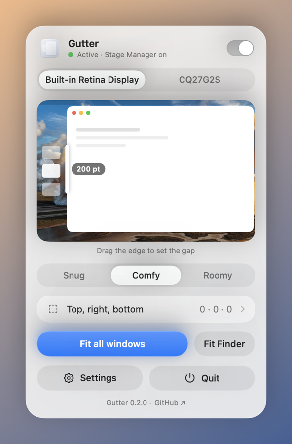

<p align="center">
  
</p>

<h1 align="center">Gutter</h1>

<p align="center">
  <b>Keep the Stage Manager strip in view.</b><br>
  A tiny macOS menu bar app that fits every new window next to it, automatically.
</p>

<p align="center">
  <a href="https://github.com/jleitaom/gutter/releases/latest"></a>
  
  <a href="LICENSE"></a>
</p>

---

## Why

Stage Manager is great for switching apps, but macOS has no default window size. New windows open
either small or full width, covering the strip of recent apps on the left, so you end up resizing
every window by hand.

Gutter watches for new windows and fits them to the screen with a margin you choose. The strip
stays visible on every display, and you never touch a window edge again.

<p align="center">
  <picture>
    <source media="(prefers-color-scheme: dark)" srcset="docs/screenshot-dark.png">
    
  </picture>
</p>

## Features

- **Auto-fit new windows** on whichever display they open on
- **Adjustable margins** (left, top, right, bottom) with a live preview and presets
- **Only with Stage Manager**: does nothing while Stage Manager is off
- **⌃⌥⌘F** fits the current window on demand
- **Never resize** list for apps you'd rather leave alone
- **Launch at login**
- **Settings window** (⌘,) for the options you set once
- **Update checks** through GitHub, with your permission and a switch to turn them off
- Native and lightweight. No tracking, no data collected. The only network access is the update check.

## Install

1. Download `Gutter-x.y.z.dmg` from the [latest release](https://github.com/jleitaom/gutter/releases/latest).
2. Drag **Gutter** into **Applications** and open it.
3. macOS will say it can't verify the app. Open **System Settings → Privacy & Security**, scroll
   down and click **Open Anyway**. You only need to do this once.
4. Click the Gutter icon in the menu bar → **Grant Access…**, then turn Gutter on under
   **System Settings → Privacy & Security → Accessibility**.

Updates keep that access: every release is signed with the same certificate, so macOS
recognizes the new version as the same app.

### Why the warning?

Gutter is free and isn't distributed through Apple's paid developer program, so macOS can't vouch
for it. Instead, every release is built in public by GitHub Actions from the source in this repo,
and you can check that your download matches:

```sh
gh attestation verify Gutter-0.1.0.dmg --repo jleitaom/gutter
```

See [SECURITY.md](SECURITY.md) for details, or build it yourself (below).

## Build from source

Building needs Xcode 26 or later (Swift 6.2), or the matching Swift toolchain. The app itself
runs on macOS 14 and later.

```sh
git clone https://github.com/jleitaom/gutter.git
cd gutter
./build.sh --install    # builds, copies to /Applications and launches
```

Your builds are ad-hoc signed, so macOS treats each rebuild as a new app. After rebuilding,
remove Gutter from the Accessibility list (–) and add it again. To avoid that, create a
self-signed code signing certificate named `Gutter Self-Signed` in Keychain Access
(Certificate Assistant → Create a Certificate, type Code Signing); `build.sh` uses it
automatically.

## How it works

Gutter uses the macOS Accessibility API to listen for `AXWindowCreated` events from running apps.
When a standard window appears, it's moved and resized to the screen's visible area minus your
margins. Dialogs, sheets, full-screen and non-resizable windows are left alone. Whether Stage
Manager is on is read from the `com.apple.WindowManager` preferences.

## Releasing

Push a version tag. GitHub Actions builds a universal (Apple Silicon + Intel) app and publishes a
`.dmg`, a `.zip`, checksums and build attestations:

```sh
git tag v0.1.0 && git push origin v0.1.0
```

To package locally: `scripts/package.sh 0.1.0`. To regenerate the icon: `swift scripts/make-icon.swift`.

## Contributing

Issues and pull requests are welcome. See [CONTRIBUTING.md](CONTRIBUTING.md).

## License

[MIT](LICENSE) © José Leitão

Gutter is an independent project and is not affiliated with Apple. Stage Manager and macOS are
trademarks of Apple Inc.
